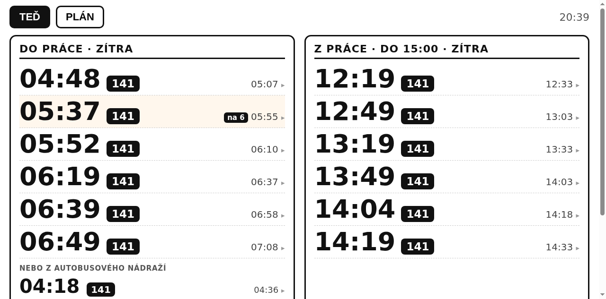

# Jablonecké spojení

Odjezdy z jabloneckých zastávek nad daty GTFS — hledání spojení, oblíbené trasy, přestupy, plán dojíždění a displej na stůl.



## Instalace do Home Assistant

Repozitář je zároveň **add-on repository**:

1. HA → Nastavení → Doplňky → Obchod s doplňky → **⋮ → Repozitáře**
2. Přidat `https://github.com/czechtechgeek/jizdnirady`
3. Nainstalovat **Jablonecké spojení** a spustit

Po startu je aplikace v postranním panelu **Odjezdy** (ingress) a zároveň na `http://homeassistant.local:8099` (PWA, displej, senzory). První start stahuje GTFS a staví databázi — několik minut. Podrobnosti v [`addon/README.md`](addon/README.md).

Pro senzory v HA (bez add-onu) použij [`homeassistant/`](homeassistant/README.md).

## Co to umí

- **Hledání spojení** mezi dvěma zastávkami s našeptávačem (všechny zastávky IDOL, Liberecký kraj a navazující linky).
- **Přestupy** — pokud nejede přímý spoj, zkusí jedno přestupové spojení (min. 3 minuty na přestup, max. 45 minut čekání). Výsledky se cachují na 5 minut.
- **Oblíbené trasy** a **historie hledání** v samostatné `user.db` — přežije přestavbu jízdních řádů.
- **Displej** (`/display`) pro tablet nebo malý monitor: tři režimy, velké časy, klik na spoj rozbalí všechny zastávky.
  - **TEĎ** — co jede právě teď (včetně alternativy z jiné zastávky).
  - **PLÁN** — typický pracovní den: ráno „na 6“ a odpoledne „před 15:00“.
  - **ČAS** — zvolíte hodinu a displej ukáže, co jede od té doby; hodí se na „co kdybych jel v 16:00“.
  - Z práce se zobrazují i spoje **po 15:00** (se štítkem „po 15“) a 4 varianty **přes autobusové nádraží**.
  - Spoje, které už splní **týdenní fond hodin**, mají zelenou značku „týden“ (nastavení v `commute.json` → `work_hours`).
- **PWA** — jde nainstalovat na plochu PC, tabletu i telefonu, funguje offline (shell se cachuje, data vždy ze sítě).
- **Home Assistant** — hotový balíček s REST senzory a automatizací, viz [`homeassistant/`](homeassistant/).

## Rychlý start

```bash
git clone https://github.com/czechtechgeek/jizdnirady.git
cd jizdnirady

python3 -m pip install --user -r requirements.txt

# stáhne GTFS (~84 MB) a postaví jizdnirady.db (~60 MB)
./packaging/fetch_gtfs.sh

python3 app.py          # http://localhost:8099
```

Jako službu (systemd --user):

```bash
./packaging/install.sh 8099
```

## Konfigurace dojíždění

`commute.json` řídí displej:

```json
{
  "home": "Jablonec nad Nisou, Podhorská Vikýř",
  "work": "Jablonec nad Nisou, Lukášov, Cihelná",
  "alt_home": "Jablonec nad Nisou, autobusové nádraží",
  "arrive_by": "06:05",
  "leave_before": "15:00",
  "leave_after": "12:00",
  "home_label": "Doma",
  "work_label": "Práce"
}
```

- `arrive_by` — nejpozdější přijatelný příjezd do práce; spoj, který ho splní, dostane na displeji štítek **„na 6“**.
- `leave_before` / `leave_after` — okno, ve kterém se zobrazují spoje z práce.
- `alt_home` — záložní zastávka (např. když dojdete pěšky na autobusové nádraží).
- Ranní nabídka ukazuje **maximálně jeden spoj před cílovým příjezdem** a zbytek po něm.

## HTTP API

| Endpoint | Popis |
|---|---|
| `GET /api/stops?q=` | našeptávač zastávek |
| `GET /api/next?from=&to=&at=HH:MM` | nejbližší spoje (přímé i s jedním přestupem) |
| `GET /api/trip?trip=&s1=&s2=` | zastávky jednoho spoje mezi nástupem a výstupem |
| `GET /api/display` | data pro displej (oba směry, plán, minuty do odjezdu) |
| `GET /api/favorites` · `POST` · `DELETE` | oblíbené trasy |
| `GET /api/insights` | souhrn dojíždění z historie |
| `GET /healthz` | healthcheck |

Příklad:

```bash
curl 'http://localhost:8099/api/next?from=Jablonec%20nad%20Nisou,%20Brandl&to=Liberec,%20F%C3%BCgnerova'
```

## Instalace jako aplikace (PWA)

Na počítači i telefonu jde web nainstalovat na plochu a spustit bez adresního řádku:

- **Chrome / Edge (PC):** adresní řádek → ikona „Instalovat“ (nebo menu ⋮ → *Uložit a sdílet → Nainstalovat*).
- **Android:** menu ⋮ → *Přidat na plochu*.
- **iPhone/iPad:** Sdílet → *Přidat na plochu*.

**Pozor na HTTP:** service worker (a tedy instalace) funguje jen v „secure context“ — HTTPS nebo `localhost`.
Přes holé `http://192.168.x.x` prohlížeč manifest načte, ale instalaci nenabídne. Možnosti:

1. **Chrome flag (nejrychlejší, jen pro ten počítač):**
   `chrome://flags/#unsafely-treat-insecure-origin-as-secure` → přidat `http://192.168.88.37:8099` → Enabled → restart Chromu.
2. **HTTPS certifikát** (mkcert) a spuštění aplikace s `--cert/--key` — instalace pak funguje na všech zařízeních, kde je certifikát důvěryhodný.
3. **Cloudflare Tunnel** na vlastní subdoménu (např. `spojeni.czechtechgeek.cz`) — HTTPS a dostupnost i mimo domácí síť.

Výhody PWA: offline shell (poslední stránka se zobrazí i bez sítě), vlastní ikona, celoobrazovkový režim, a na displeji navíc **Wake Lock** — obrazovka nezhasíná.

## Home Assistant

Viz [`homeassistant/README.md`](homeassistant/README.md) — balíček vytvoří senzory `sensor.spojeni_do_prace`, `sensor.spojeni_z_prace`, `sensor.spojeni_dalsi_odjezd` a automatizaci na připomenutí odjezdu. Displej lze vložit i jako `panel_iframe`.

## Struktura

```
app.py                 Flask aplikace a API
transfers.py           hledání spojení s jedním přestupem
build_db.py            stavba SQLite databáze z GTFS
report.py              souhrn dojíždění (pro cron)
commute.json           konfigurace displeje
templates/index.html   hledání spojení
templates/display.html displej na stůl
static/sw.js, manifest PWA
homeassistant/         balíček a karta pro HA
packaging/             systemd unit, instalace, stažení GTFS
```

## Data

- GTFS: [IDOL / SPOJENKA](https://www.spojenka.cz/jrdata/jizdnirady-gtfs.zip) — jízdní řády Libereckého kraje.
- `jizdnirady.db` se generuje lokálně, v repu není.
- `user.db` (oblíbené a historie) zůstává mimo git.

## Omezení

- Jen přímé spoje a maximálně jeden přestup.
- Jízdní řády jsou plánované, ne real-time — zpoždění se nezobrazují.
- Data se aktualizují ručně (`packaging/fetch_gtfs.sh`); jízdní řády se mění několikrát ročně.

## Licence

MIT — viz [LICENSE](LICENSE).
